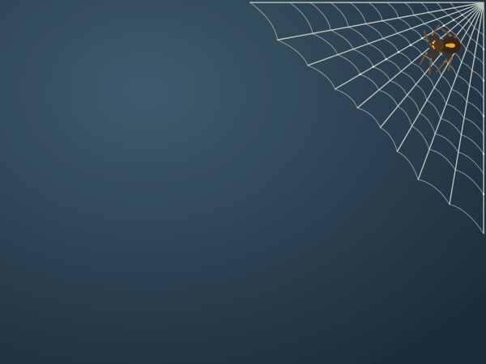
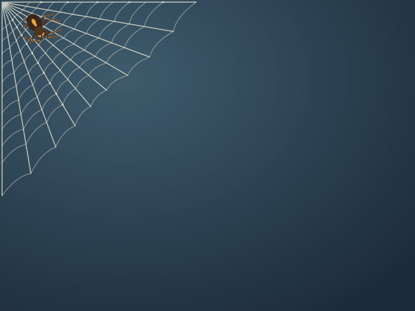
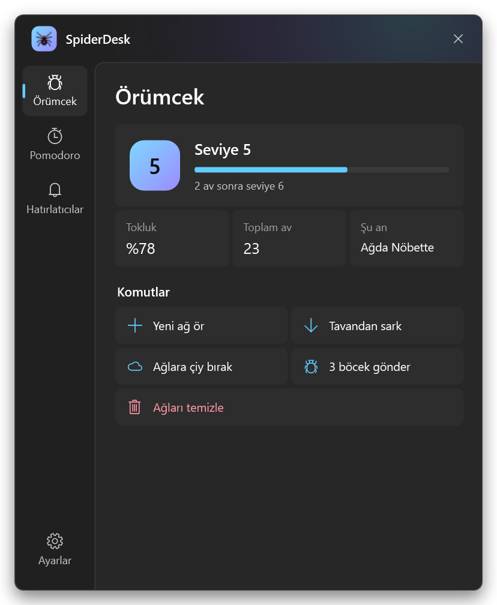
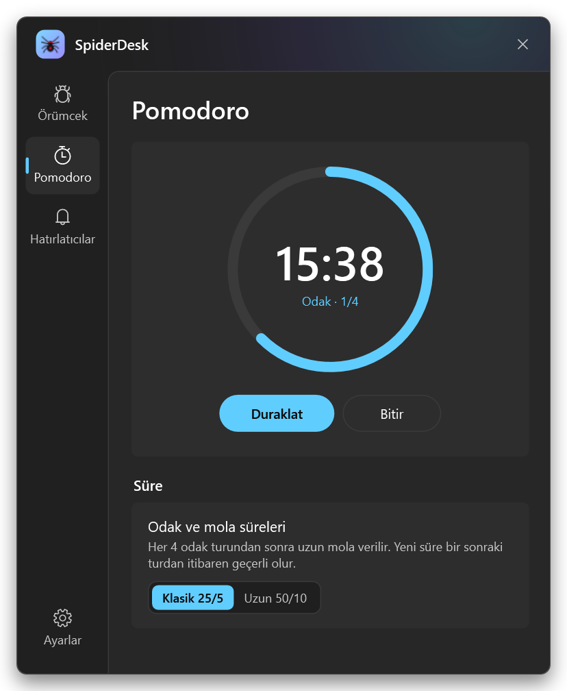
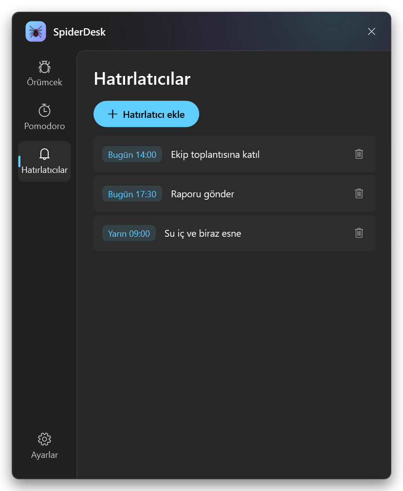
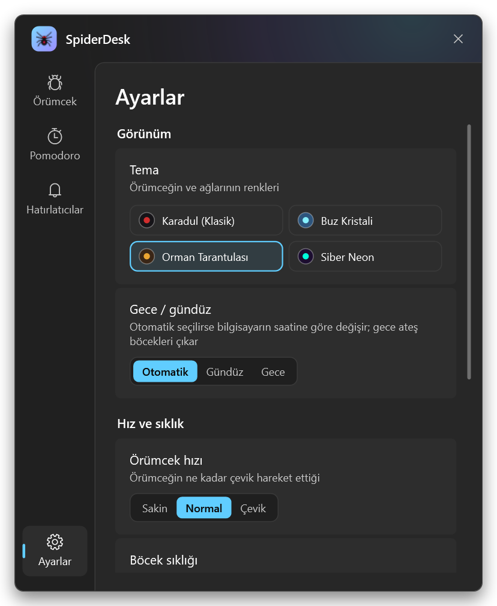

# 🕷️ SpiderDesk

A small, friendly desktop spider that hangs out on your Windows desktop.

It wanders around your screen, weaves webs in the corners, catches passing bugs, shakes off raindrops, and takes naps when there's nothing to do. It can even keep your focus sessions with a built-in Pomodoro timer and remind you of things by rappelling down with a note.

It runs quietly in the background without getting in your way or eating up your battery.

## 🎬 Demo

<table>
  <tr>
    <td align="center"></td>
    <td align="center"></td>
  </tr>
  <tr>
    <td align="center"><em>Catching a bug and storing the cocoon</em></td>
    <td align="center"><em>Shaking rain off a heavy web</em></td>
  </tr>
  <tr>
    <td align="center"></td>
    <td align="center"></td>
  </tr>
  <tr>
    <td align="center"><em>Starting a Pomodoro: the spider writes FOCUS</em></td>
    <td align="center"><em>A reminder arrives on a paper note</em></td>
  </tr>
</table>

### ⚙️ The settings window

Click the spider icon in the System Tray and this window opens right above it.

<table>
  <tr>
    <td align="center"></td>
    <td align="center"></td>
  </tr>
  <tr>
    <td align="center"><em>Spider: level, stats and commands</em></td>
    <td align="center"><em>Pomodoro: countdown ring</em></td>
  </tr>
  <tr>
    <td align="center"></td>
    <td align="center"></td>
  </tr>
  <tr>
    <td align="center"><em>Reminders: what is coming up</em></td>
    <td align="center"><em>Settings: themes, speeds and more</em></td>
  </tr>
</table>

---

## 🌿 What it does

- **🕷️ Procedural walking:** Crawls around naturally with 8-legged Inverse Kinematics (IK) physics.
- **🕸️ Web weaving:** Spins both round orb webs and cozy corner webs.
- **🐛 Bug hunting:** Catches wandering flies, moths, fireflies, and wasps, wraps them in silk, and stores them in its pantry.
- **💧 Rain & Dew physics:** Water droplets collect on the silk threads (or you can rain on them from the settings window). When the web sags under their weight, the spider walks over and shakes them off.
- **🍃 Light breeze:** An occasional room breeze gently sways the webs.
- **👋 Silk greeting:** On startup the spider writes a greeting for the time of day (*GOOD MORNING, HELLO, GOOD EVENING, GOOD NIGHT*) in silk, then spins its first web.
- **🍅 Pomodoro timer:** Start 25/5 or 50/10 minute focus sessions from the settings window, with a countdown ring you can pause and resume. When a session ends you get a notification and the spider writes **FOCUS** or **BREAK** in silk, even on top of a fullscreen app, with only the spider and its text visible. The countdown starts once the spider has finished writing.
- **⏰ Reminders:** Add a reminder from the settings window (*in 5/15/30 minutes, an hour, or at 14:30*). When it is time, you get a notification and the spider rappels down from the top of the screen holding a paper note with your text, even on top of a fullscreen app. Reminders are saved, so ones you missed while the computer was off are shown the next time it starts.
- **🖱️ Click-through:** Lives behind your work and games. You can click right through the webs without anything getting blocked.

---

## 🚀 How to Run

You can run SpiderDesk directly from the source code using the [.NET 9.0 SDK](https://dotnet.microsoft.com/download/dotnet/9.0):

```bash
# 1. Clone the repository
git clone https://github.com/eamre/spider-desk.git
cd spider-desk

# 2. Run directly
dotnet run
```

That's it! The spider will appear on your desktop, and its control icon will show up in the Windows System Tray (near the clock).

### (Optional) Build a standalone executable
If you want to compile a single portable binary for yourself:

```bash
dotnet publish -c Release -r win-x64 --self-contained false -p:PublishSingleFile=true -o ./publish
```

The compiled executable will be located in `./publish/SpiderDesk.exe`.

> **Note:** SpiderDesk stores your chosen preferences (selected theme, spawn rates, Pomodoro length) in `%LocalAppData%\SpiderDesk\settings.json`, and your reminders in `reminders.json` next to it. If enabled in the settings window, it can also add itself to the programs Windows starts at sign-in.

---

## 🎮 Controls

**Click the spider icon in the System Tray** (by the clock) to open the settings window right above it. Click outside it, press Esc or click the icon again to close it. It has four tabs:
- 🕷️ **Spider:** its level and how many bugs until the next one, how full it is, what it is doing now, and commands: weave a new web, rappel down, rain on the webs, send bugs, clear the webs
- 🍅 **Pomodoro:** a countdown ring with start, pause, resume and finish, and 25/5 or 50/10 minutes (the countdown also shows when you hover over the tray icon)
- ⏰ **Reminders:** your waiting reminders, and a card to add a new one (type *1959* and it becomes *19:59*)
- ⚙️ **Settings:** theme (*Black Widow, Frost Crystal, Forest Tarantula, Cyber Neon*), day/night, speeds, always on top, start with Windows

**Right-click** the tray icon for the quick menu: Settings, Pause and Exit.

**Mouse interactions:**
- Drag your mouse across a web to pluck the silk — the spider will run over to investigate!
- Move the cursor quickly towards the spider to startle it.

---

## 🗂️ Project Structure

```
SpiderDesk/
├── Core/                  Only what the simulation and the Windows side both need (AppDiagnostics)
│   ├── Settings/          UserSettings, how they are saved, presets
│   └── Services/          The clock contract: day/night and time of day
├── Domain/                The simulation itself: never draws, never calls Windows APIs
│   ├── Spider/            SpiderEntity, IK legs, gait, metabolism, prey search, message queue, silk line, tuning constants
│   │   ├── States/        14 behaviours: WritingSilkMessage, DeliveringNote, Wandering, SpinningWeb, Hunting...
│   │   └── Themes/        Black Widow, Frost Crystal, Forest Tarantula, Cyber Neon
│   ├── Insects/           BugEntity, BugSpawner
│   │   ├── States/        Flying, Perching, Trapped, BeingWrapped
│   │   └── Species/       Housefly, green fly, golden moth, firefly, wasp
│   ├── Web/               Web entity, blueprint generator, breeze, droplets, pantry, physics constants
│   ├── SilkText/          Silk letters, text layout and the startup greeting
│   ├── Pomodoro/          Pomodoro timer, session lengths, countdown and notification texts
│   ├── Reminders/         Reminders: the list, time parsing ("15 min", "14:30") and text rules
│   ├── Overlay/           Pure rules for the overlay: 60 FPS when moving, 20 Hz when still, pause when covered, raising notes over apps
│   ├── SimulationEngine   Runs one simulation step per frame
│   └── WorldContext       Everything the spider can see: webs, bugs, cursor, screen size
├── Rendering/             Turns the world into WPF drawings: spider, bugs, silk text, the paper note
│   └── Web/               Web drawing (each web in its own visual)
├── Infrastructure/        The Windows side
│   ├── Flyout/            The settings flyout next to the tray: one page per tab (spider, Pomodoro, reminders, settings)
│   ├── Platform/          Run at Windows startup (registry) and the system clock
│   ├── Sessions/          The frame loop, and wiring each tab to the spider: spider, settings, Pomodoro, reminders
│   ├── Storage/           Saves settings.json and reminders.json
│   ├── Tray/              Tray icon, its small menu, the Pomodoro tooltip and notifications
│   └── Windowing/         Click-through window, cursor, fullscreen detection (Win32 behind interfaces, tested with a fake desktop)
├── tests/SpiderDesk.Tests/  xUnit tests, same folder layout as the app (run: dotnet test)
├── App.xaml.cs            Composition root: creates and wires everything together
└── MainWindow.cs          The transparent overlay window
```

Dependencies point one way: `Domain` knows nothing about `Rendering` or `Infrastructure`, and `Core` depends on nothing.
One conscious trade-off: `Domain` uses WPF's `Point`, `Vector` and `Color` types instead of its own. SpiderDesk only runs on Windows,
so writing separate geometry and colour types would add code without adding value.

### ⚡ Performance
- **Rests behind fullscreen apps:** while a game or video covers the desktop, nothing is drawn.
- **Slows down when idle:** smooth animation while something moves, a much lower frame rate when the scene is still.
- **Redraws only what changes:** a still web is drawn once and reused; only moving webs are redrawn.

---

## 🛠️ Built with
- **C# / .NET 9**
- **WPF** (Windows Presentation Foundation)

---

## 📄 License
Distributed under the [MIT License](LICENSE).

